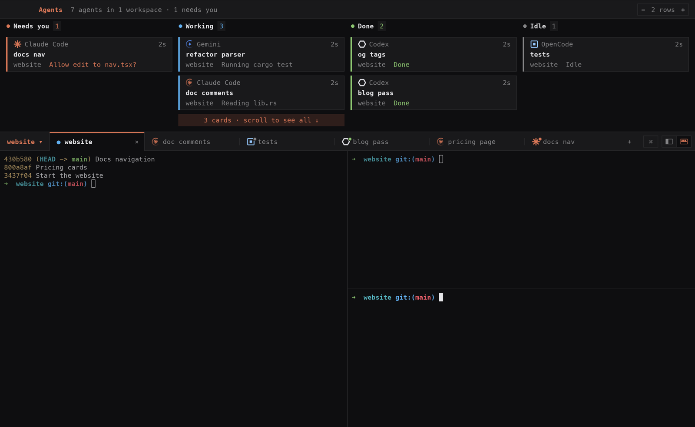
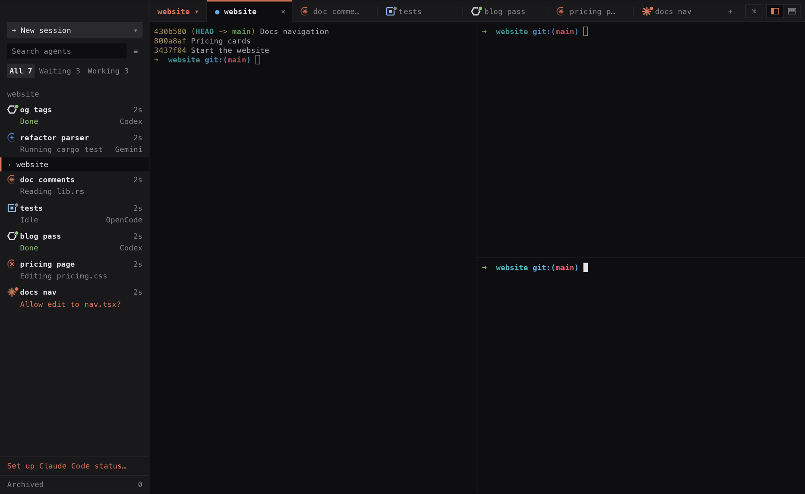
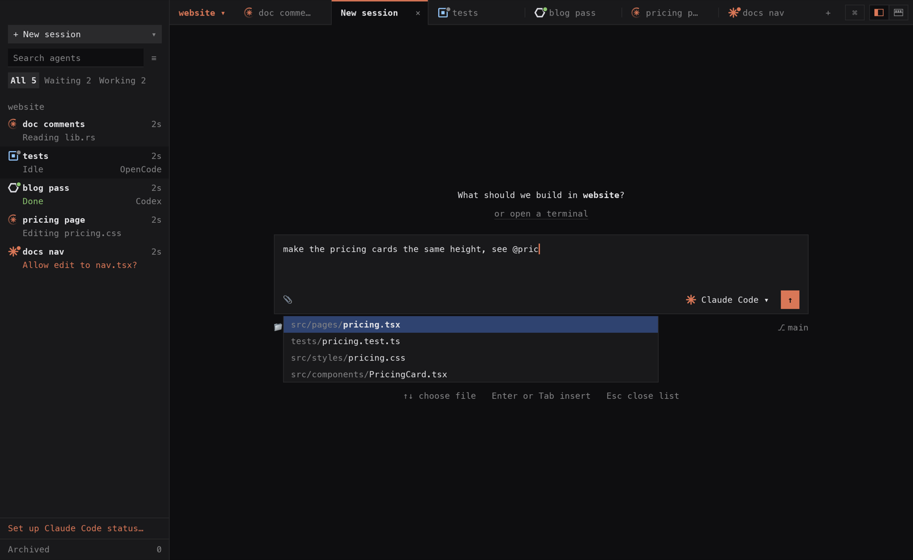

# ale-term

**A fast, private terminal for macOS, built for working with coding agents.**

Tabs, splits and a workspace per project, plus a sidebar, a board and a graph
that show what every coding agent is doing: which one is working, which one
has finished, and which one is waiting for you. No telemetry and no network
access: the app never opens a connection. About 45 MB of memory with a tab
open, and a first frame in about 120 ms.



- **Agent status at a glance**: working, needs you, done or idle, for Claude
  Code and Kiro (reported by their hooks) and Codex, Gemini CLI and OpenCode
  (followed by watching the pane).
- **Two layouts**: a sidebar grouped by project or by status, or a board of
  cards docked above the tabs.
- **A start page for new sessions**: type a task, pick one of the agents
  installed on this Mac, and refer to files with `@`.
- **The agent graph**: Claude Code's subagents and background tasks as a
  tree, with what each was asked and what it answered.
- **A complete terminal underneath**: workspaces with templates, session
  restore, search, prompt jumping, inline images and Cmd-click links.

## Contents

- [Quick start](#quick-start)
- [Commands and shortcuts](#commands-and-shortcuts)
- [Command line](#command-line)
- [Agents](#agents)
- [Workspaces](#workspaces)
- [Shell integration](#shell-integration)
- [Inline images](#inline-images)
- [Settings](#settings)
- [Privacy](#privacy)
- [Rendering and memory](#rendering-and-memory)
- [Development](#development)
- [License](#license)

## Quick start

> Needs macOS and a Rust toolchain: `brew install rustup && rustup default stable`.

```sh
./scripts/bundle.sh                # builds target/release/ale-term.app
open target/release/ale-term.app
```

Then:

1. Press **Shift+Cmd+T** for a new session: type what to build, pick an
   agent and press Enter. **Cmd+T** opens a plain terminal tab instead.
2. When an agent runs, accept the offer to set up its status hooks (Claude
   Code, Kiro) so ale-term knows exactly when it works, finishes or needs you.
3. Press **Option+Cmd+B** to switch between the sidebar and the board, and
   **Shift+Cmd+P** to find any command by name.

To keep the app, drag `target/release/ale-term.app` into Applications. It is
signed for this Mac only; to give it to someone else, have them build it or
sign it with a Developer ID.

## Commands and shortcuts

Every command is in the command palette (**Shift+Cmd+P**): type a few letters
of its name. In the shortcuts, ⌘ is Command, ⇧ Shift, ⌥ Option and ⌃ Control.

<!-- commands:start -->

| Command | Shortcut |
|---|---|
| **Tabs and panes** | |
| New Tab | `⌘T` |
| Close Pane | `⌘W` |
| Close Tab | `⇧⌘W` |
| Rename Tab |  |
| Split Right | `⌘D` |
| Split Down | `⇧⌘D` |
| Next Tab | `⌃Tab` |
| Previous Tab | `⌃⇧Tab` |
| Next Pane | `⌘]` |
| Previous Pane | `⌘[` |
| Focus Pane Left | `⌥⌘←` |
| Focus Pane Right | `⌥⌘→` |
| Focus Pane Above | `⌥⌘↑` |
| Focus Pane Below | `⌥⌘↓` |
| **Workspaces** | |
| Switch Workspace | `⌘P` |
| Next Workspace | `⌃⌘→` |
| Previous Workspace | `⌃⌘←` |
| New Workspace |  |
| Rename Workspace |  |
| Move Tab to Workspace |  |
| Set Up Workspace Tabs from Template |  |
| **Agents** | |
| Toggle Sidebar or Docked Board | `⌘B` |
| Switch Layout: Sidebar / Board | `⌥⌘B` |
| Toggle Agent Board | `⇧⌘B` |
| Toggle Agent Graph | `⌥⌘G` |
| New Agent Session | `⇧⌘T` |
| Resume Archived Session |  |
| Clear Session Archive |  |
| Go to Next Agent That Needs You | `⇧⌘A` |
| Set Up Claude Code Status Hooks |  |
| Remove Claude Code Status Hooks |  |
| Set Up Kiro Status Hooks |  |
| Remove Kiro Status Hooks |  |
| **Text, search and scrolling** | |
| Copy | `⌘C` |
| Paste | `⌘V` |
| Find in Scrollback | `⌘F` |
| Find Next | `⌘G` |
| Find Previous | `⇧⌘G` |
| Jump to Previous Prompt | `⌘↑` |
| Jump to Next Prompt | `⌘↓` |
| Scroll Page Up | `⇧PgUp` |
| Scroll Page Down | `⇧PgDn` |
| Scroll to Top | `⌘Home` |
| Scroll to Bottom | `⌘End` |
| Clear Scrollback | `⌘K` |
| **Window and app** | |
| Increase Font Size | `⌘+` |
| Decrease Font Size | `⌘-` |
| Reset Font Size | `⌘0` |
| Toggle Full Screen | `⌃⌘F` |
| Command Palette | `⇧⌘P` |
| Settings | `⌘,` |
| Open Settings File |  |
| Quit ale-term | `⌘Q` |

<!-- commands:end -->

Other keys:

| Keys | Where | What they do |
|---|---|---|
| `⌘1` … `⌘9` | Anywhere | Go to that tab; `⌘9` goes to the last one |
| `⇧⌘]` / `⇧⌘[` | Anywhere | Next / previous tab |
| `Enter` / `⇧Enter` | Find bar (`⌘F`) | Older / newer match |
| `Enter` | New session page | Start the agent on the task |
| `⇧Enter` | New session page | New line |
| `⌘Enter` | New session page | Open a plain terminal instead |
| `Tab` | New session page | Choose the agent |
| `@` | New session page | Refer to a file: `↑` `↓` choose, `Enter` or `Tab` insert, `Esc` close the list |
| `Esc` | New session page | Close the page |
| Arrows, `Enter` | Agent board (`⇧⌘B`) | Move between cards; go to the agent |
| Arrows, `Enter` | Settings (`⌘,`) | Move and change values; edit text. `⌘E` opens the file |

**Mouse.** Drag to select (double-click a word, triple-click a line), drag the
line between panes to resize, click the × on a tab (or middle-click it) to
close it. Double-click the tab in front to rename it in place: type the new
name and press Enter (Esc keeps the old one; an empty name brings back the
automatic title). Rest the pointer on a tab whose title is cut short and the title
slowly scrolls by, so all of it can be read. Hold Shift to
select text in programs that capture the mouse. Hold Cmd and click a web
address or file path to open it. While Cmd is held over a link, where it
really leads is shown at the bottom of the window. Programs, scripts,
installers and shortcut files are shown in the Finder instead of being
opened, so a link in a terminal cannot run anything; `file://` links to
other machines are ignored.

## Command line

```text
ale-term [--cwd <dir>]               start, with the first tab in <dir>
ale-term --version | --help
ale-term hooks status                which agents' status hooks are installed
ale-term hooks install claude|kiro   add an agent's status hooks
ale-term hooks remove claude|kiro    take them out again
```

In the app bundle the program is
`target/release/ale-term.app/Contents/MacOS/ale-term`; from source, use
`cargo run -p ale-term -- <arguments>`. `ale-term hook <agent> [event]` is
what the installed hooks call to report to the running app; it is not meant
to be run by hand.

## Agents

<table>
<tr>
<td></td>
<td></td>
</tr>
<tr>
<td align="center">The sidebar layout</td>
<td align="center">A new session, referring to a file with <code>@</code></td>
</tr>
</table>

The sidebar lists every agent and shell, grouped by project (or by status:
the button next to the search box). Each agent shows its task, what it is
doing right now, its state and, while it works, for how long:

| State | Meaning |
|---|---|
| Working | Busy with your request |
| Needs you | Blocked on a permission prompt or a question |
| Done | Finished its turn and you have not looked yet |
| Idle | Waiting for a prompt |
| Error / Rate limited | The turn ended with a failure or a usage limit |
| Waiting on tasks | The agent stopped but is not finished: subagents, a workflow or other background work will wake it, or it scheduled its own wake-up. A shell command left running (a dev server) does not count |

Tabs and sidebar rows for an agent show a small mark for that agent with a
dot in the state's color. (The marks are simple shapes in each agent's
color, not the vendors' logos.) Click a row to jump to that pane.

When an agent is stuck waiting for you (a permission prompt, a question, an
error) while you are elsewhere, ale-term plays a sound and, if the window is
not in front, shows a macOS notification. Both can be turned off under
`[agents]`. A finished turn is never announced; it shows as Done on the tab
and in the sidebar.

**New session** (Shift+Cmd+T) opens a page asking what to build; the button
at the top of the sidebar offers that or a plain terminal. Type a task and
press Enter to start the selected agent on it; click the agent's name (or
press Tab) to pick another from a list; Cmd+Enter, or "or open a terminal",
gives a plain shell instead. Nothing runs until you choose. Closing the last
tab brings this page back instead of quitting; Cmd+Q quits.

The list of agents shows only the ones installed on this Mac, each with
where it was found. ale-term asks your login shell, the same one a tab runs,
whether each agent's command exists, so agents installed through nvm,
Homebrew, `~/.local/bin` or an alias are found even when the app is opened
from the Finder. It asks again when a page opens, at most every 30 seconds,
so a newly installed agent shows up.

Type `@` to refer to a file in the session's folder: a list of its files
narrows as you type, ↑↓ pick one and Enter or Tab puts its path in the
prompt (`@src/main.rs`), which agents such as Claude Code read. In a git
repository the list is git's own (ignored files are left out); elsewhere
the folder is searched, skipping hidden and generated folders. The
paperclip adds files chosen in the standard macOS open panel the same way.
The folder below the box is where the session will run: click it to pick
one of your workspaces' folders, or any other with "Choose folder…".

How the status is known:

- **Claude Code** reports it through hooks. ale-term offers to install them
  the first time it sees Claude Code running (a hint at the bottom of the
  sidebar, or "Set Up Claude Code Status Hooks" in the palette). They are
  added to `~/.claude/settings.json`, keep your other settings, leave a
  backup next to the file, and do nothing outside ale-term. "Remove Claude
  Code Status Hooks" takes them out again.
- **Kiro** (Kiro CLI 3, its v3 engine) reports it through hooks too,
  offered the same way ("Set Up Kiro Status Hooks"). Kiro loads hooks from
  every file in `~/.kiro/hooks/`, so ale-term writes one file of its own
  there, `ale-term.json`, and changes none of yours; "Remove Kiro Status
  Hooks" deletes it. The hooks print nothing and always succeed, so they
  never approve, block or alter anything Kiro does (a permission prompt
  still asks you), and each is given at most 5 seconds. Kiro's tools are
  shown like Claude Code's ("Editing README.md", "Running cargo test").
  This follows Kiro's published hook format and was tested by running the
  hooks' commands as Kiro would, not inside a live Kiro session. Kiro does
  not report subagents to its hooks, so the graph shows only the agent.
- **Without hooks** (Codex, Gemini CLI, OpenCode, and Claude Code or Kiro
  until their hooks are installed) the agent is recognized by its command and
  followed by watching the pane. A steady stream of updates lasting over a
  second (a spinner) means working, silence afterwards means done, and a
  bell or notification request means the agent wants you. This is a guess:
  it cannot tell "finished" from "waiting for an answer", and it shows
  Idle for an agent that works without animating anything.

Status travels over a Unix socket on this Mac; nothing uses the network.

The same can be done from a shell: `ale-term hooks status` says what is
installed, and `ale-term hooks install claude` (or `kiro`) and `ale-term
hooks remove claude` (or `kiro`) add and take out the hooks.

**Summary**: rest the pointer on an agent's tab, sidebar row or board card
for a moment and a card shows what it has been doing: its task and state,
the last thing it said (for Claude Code, read from its own conversation
file; at the end of a turn this is usually its account of what it did), and
its latest actions ("Editing src/styles/pricing.css", "Running npm test")
with how long ago each began. The actions come from the status hooks, so
Claude Code and Kiro with hooks installed show them. A click puts the card
away.

**Board** (Shift+Cmd+B): every agent as a card in four columns, Needs you,
Working, Done and Idle. Click a card, or move with the arrow keys and press
Enter, to jump to that agent.

**Board layout**: instead of the sidebar, the agents can sit on a board
docked across the top of the window, with the tabs and panes below it.
Switch with the two small buttons at the right end of the tab bar (sidebar
or board), with Option+Cmd+B, or with "Layout" in the settings; the choice
is saved in the settings file. The board shows each column's cards in a set
number of rows (the − and + in its header, or "Board rows" in the
settings); scroll over a column to see the rest of its cards. Its height
stays the same as agents come and go, so the terminals below are not
resized. The agent in the focused pane is outlined; click a card to go to
it. A tab you have named (double-click it) shows its name beside the
agent's, here and in the summary card: "Claude Code · api server".

**Graph** (Option+Cmd+G, or click an agent in the sidebar that has
subagents): a panel beside the agent's terminal showing the agent, the
subagents it launched, the ones those launched in turn, and its background
tasks, as a tree. Each node shows what it was asked to do and what it is
doing now, or its final answer once finished. Click a node to read its
recent output below the tree: what it was asked, what it said, and the tools
it called. This works for Claude Code with status hooks installed; the
output is read from Claude Code's own conversation files under `~/.claude`.

Claude Code offers no way for another program to send a message to a
subagent or stop one, so the graph is for watching. When a subagent's
request needs your approval the prompt appears in the agent's terminal,
which is right beside the panel.

**Archive**: when an agent's session ends it is filed under "Archived" at
the bottom of the sidebar. Picking one opens a tab in the folder it ran in;
Claude Code sessions are resumed with `claude --resume <id>`, and for other
agents the start command is typed for you to run. Only the task name, agent,
folder and session id are kept, never anything that was printed. "Clear
Session Archive" in the palette empties it.

**After a restart**, a pane that had Claude Code running gets `claude
--resume <id>` typed at its prompt; press Enter to continue that
conversation.

Codex and Gemini CLI have hook systems of their own, and `ale-term hook
<agent>` already understands their events, but installing into their
settings is not automated because it could not be tested here. To wire one
up by hand, register this as the command for each of the agent's hook
events (replace `codex` with `gemini`):

    "${ALE_TERM_BIN:-true}" hook codex

## Workspaces

Tabs are grouped by project: a tab belongs to the workspace of the git
repository its folder is in, and the tab bar shows one workspace at a time.
`cd` into another project and the tab moves to that project's workspace (and
the view follows). Tabs outside any repository live in `general`.

From the command palette you can also rename tabs and workspaces, move a tab
to another workspace (it then stays there), and create a workspace by hand.

With the mouse: drag a tab along the tab bar to reorder it; it lifts out of
the bar and follows the pointer. Drag a row in the sidebar up or down to
reorder it within its workspace, or into another workspace's group to move
its tab there (it then stays there). While you drag, the row's name follows
the pointer and a line shows where it would land.

**Templates** open a project's usual tabs in one go. Define them in the
config file:

    [[workspace]]
    root = "~/Dev/my-project"
    tabs = [
      { title = "agent", command = "claude" },
      { title = "server", command = "npm run dev" },
      { title = "git" },
    ]

and pick the project in the switcher (Cmd+P). A repository can instead carry
its own `.ale-term.toml` with the same `tabs = [...]` list; run "Set Up
Workspace Tabs from Template" to use it. ale-term shows the commands and asks
before running them, and asks again whenever that file changes.

**Session restore**: workspaces, tabs, splits and folders are reopened at
launch. A command that was running is typed at the prompt but not run; press
Enter to start it again. Only folders and command lines are saved, never
terminal contents. Turn it off with `restore = false` under `[window]`.

## Shell integration

For zsh, ale-term loads a small script (without touching your dotfiles) so
the shell reports its folder, where prompts are, and which command is
running. This gives accurate tab titles, new tabs in the right folder and
prompt jumping. Turn it off with `shell_integration = false`.

## Inline images

Both the iTerm2 protocol (`imgcat`) and the kitty graphics protocol
(`kitten icat`, `timg`, `chafa`, `yazi`) are supported for PNG, JPEG and GIF
(first frame). kitty's file and shared-memory transfer modes, animation and
Unicode placeholders are not. Sixel is not supported.

### Pictures and agents

Cmd+V with a picture on the clipboard (a screenshot, say) saves it as a PNG
in a private temporary folder and pastes that file's path; files copied in
the Finder paste as their paths. Claude Code attaches a pasted image path
as `[Image #N]`. The saved files are deleted when ale-term quits.

Rest the pointer on an `[Image #N]` in a Claude Code pane to see the
picture. It is read from Claude Code's own temporary folder, found exactly
when the status hooks are installed and by project folder otherwise. With
Cmd held, the path of any PNG, JPEG or GIF file previews the same way.

## Settings

Cmd+, opens the settings screen: arrow keys to move and change values,
Enter to toggle or to edit text. Changes apply immediately.

The screen is a view onto one file, `~/.config/ale-term/config.toml`, which
is created on first run with every option documented. Editing the file
directly works just as well and is how colors and workspace templates are
set; changes apply when it is saved. Changes made from the settings screen
rewrite only the affected line, leaving your comments and layout alone. If
the file has an error, ale-term says so and keeps the previous settings.

## Privacy

ale-term makes no network connections: there is no telemetry, no update
check and no crash reporting, and no networking library is linked in.
Agents report their status over a Unix socket on this Mac.

What it stores, all under `~/.config/ale-term/`:

| File | Contents |
|---|---|
| `config.toml` | Your settings |
| `state/session.json` | Open workspaces, tabs, splits, folders and running command lines, for restoring |
| `state/archive.json` | Ended agent sessions: task name, agent, folder, session id |
| `state/approved.json` | Per-project template files you allowed to run |
| `shell-integration/` | The zsh script it loads |

Nothing a terminal or an agent printed is ever written to disk. It reads
Claude Code's own conversation files under `~/.claude` to show a subagent's
output. It writes to `~/.claude/settings.json`, or creates
`~/.kiro/hooks/ale-term.json`, only if you ask it to install that agent's
status hooks.

## Rendering and memory

By default the window is painted on the CPU into memory shared with the
macOS compositor, repainting only the parts that changed. This keeps memory
low (about 45 MB with a tab open, whether idle or busy).

Set `renderer = "gpu"` under `[window]` to draw with the graphics card
instead. That is faster for very large windows under heavy output, but on
Apple GPUs the graphics driver holds about 90 MB of working memory while the
screen is changing (about 150 MB in total).

## Development

```sh
cargo run -p ale-term                 # run from source
cargo test --workspace                # all tests
cargo clippy --workspace --all-targets
python3 scripts/readme-commands.py    # refresh the command table in this README
python3 scripts/make-icon.py          # regenerate the app icon
```

A test fails when a command is added to the palette but not to the table
above; running `scripts/readme-commands.py` brings the table up to date.

**Snapshots.** `ale-term --snapshot out.bmp` draws the window into a BMP file
and quits, for checking changes by eye. `--snapshot-delay <ms>` waits first,
`--type <text>` types into the first pane, `--demo` adds a tab and two
splits, and each `--do <step>` runs a palette command by name or a test step:
`type:<text>`, `wait:<ms>`, `demo:tabs`, `demo:agents` (pretend agents in
every pane), `start:agents`, `start:folder`, `hover-tab:<tab>:<seconds>`,
`rename:<tab>`, `summary:<tab>` or `setting:<section.key>:+`. The screenshots in this README were made that way,
from a sample project with pretend agents.

**Code layout**

| Crate | Role |
|---|---|
| `crates/core` | Shell sessions: PTY plus terminal emulation (`alacritty_terminal`) |
| `crates/render` | Drawing rectangles, glyphs and images: a CPU renderer (default) and a GPU one (`wgpu`); text via `cosmic-text` |
| `crates/config` | Config file and themes |
| `crates/agents` | Agent detection, status reports and session state |
| `crates/app` | Window, tabs, splits, keyboard and mouse |

## License

MIT or Apache-2.0, at your option.
